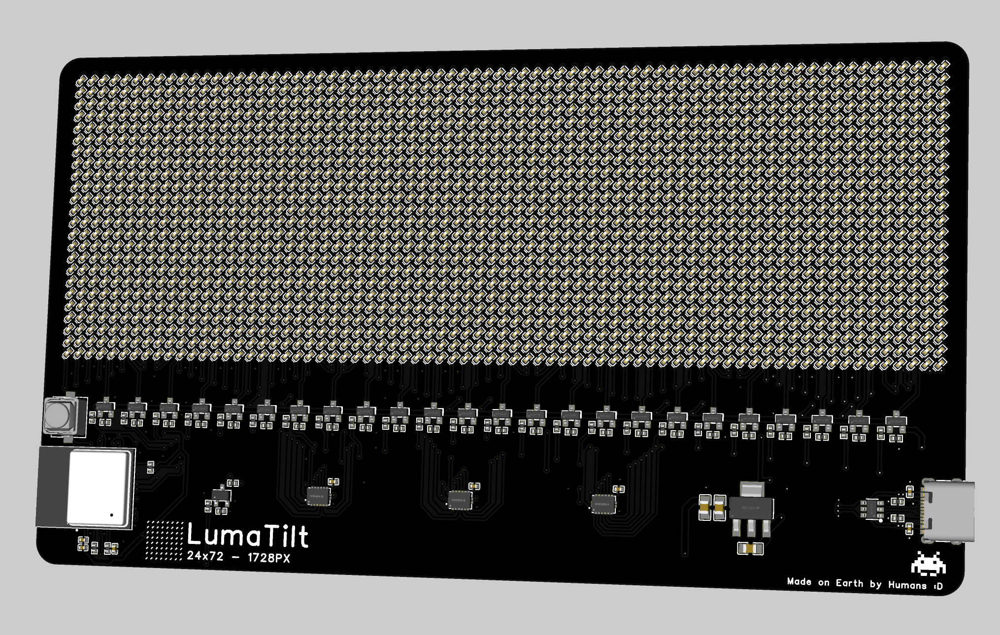
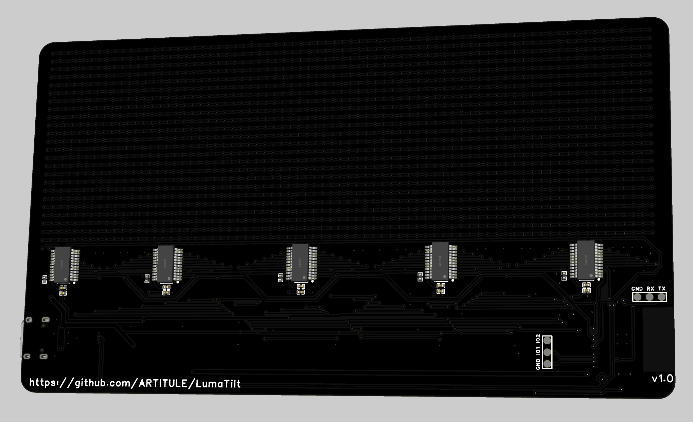
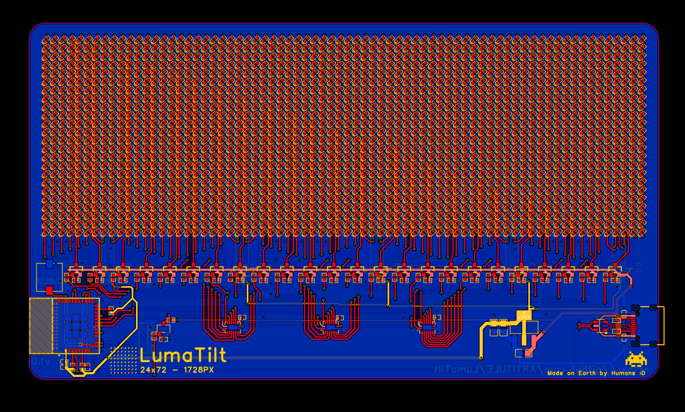

# LumaTilt

LumaTilt is a 24x72 LED Matrix Display that can be used to display graphics. The LED Matrix consists of 1728 0402 SMD LED's that are multiplexed to form the 24x72 matrix.

It is powered with a ESP32 C3 MINI 1 microcontroller that allows this display to be used with data that you get from the internet like NTP Time data, Wether monitoring etc.

This project was made as a part of my week 4 submission to Half Life.

|           Front Picture              |            Back Picture            |
|--------------------------------------|------------------------------------|
|||

## PCB Design

The PCB is a 2 Layer board about 150mm by 85mm in size. The front houses the LED matrix alongside the ESP32 module and the row controllers. The back side has the column controllers. 3 74HCT595 shift registers alongside 24 P Channel Mosfets are used to drive the display rows and 5 TLC59282 Drivers are used to drive the display columns.

All of the PCB files can be found in the [PCB_Files](/PCB_Files/) folder. There you can also find the BOM for the PCB.

For anyone interested here is the schematic:

## Firmware Installation

Note: This guide assumes that you have PlatformIO installed and configured.

1. Clone or download the repository.
2. Initialize the PlatformIO extension.
3. Connect the board to your computer.
4. Select the "LumaTilt" environment.
5. Upload the firmware and enjoy!

## BOM

Please note that some of the parts on LCSC have a minimum ordering quantity.

|Item                                                            |Qty|Supplier|Cost/item     |Total Cost|link                |
|----------------------------------------------------------------|---|--------|--------------|----------|--------------------|
|PCB                                                             |1  |JLCPCB  |$9.90         |$9.90     |[JLCPCB](https://jlcpcb.com)|
|Components from LCSC(Please upload the PCB BOM to their website)|1  |LCSC    |$60(Estimated)|$60       |[LCSC](https://www.lcsc.com)|
|Estimated total shipping                                        |1  |        |              |$20.00    |                    |
|Estimated TOTAL                                                 |   |        |              |$89.9     |                    |